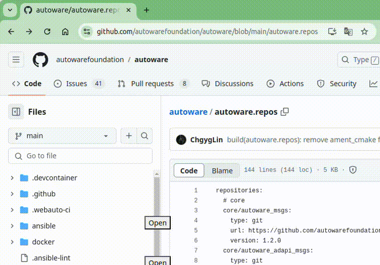

# vcstool & Ansible Galaxy repo shortcut (Chrome extension)

A Chrome extension that adds shortcut buttons on GitHub to open git repository URLs from **vcstool** `.repos` files and **Ansible Galaxy** requirements files (`requirements.yml`, `requirements.yaml`, `ansible-galaxy-requirements.yaml`).

## Demo

## Features

- 🚀 Detects `.repos` and Ansible Galaxy requirements files on GitHub
- 🎯 Adds "Open" buttons next to each git repository entry (vcstool blocks; Galaxy list items with `type: git`, `src`, etc.)
- 🔗 Supports SSH and HTTPS URLs (`git+https://`, URL fragments, inline `#` comments)
- 📦 Opens the correct branch, tag, or commit on GitHub when a version is specified
- ⚡ Real-time URL monitoring with GitHub SPA navigation

## Installation

Install from [Chrome Web Store](https://chromewebstore.google.com/detail/vcstool-repos-shortcut-ex/pphgbpclcbjlfhbkkpenkcljjkdggmnp)

## For developers
1. Fork this repository and clone it to your local machine
2. Open Chrome and navigate to `chrome://extensions/`
3. Enable "Developer mode" in the top right
4. Click "Load unpacked" and select this directory